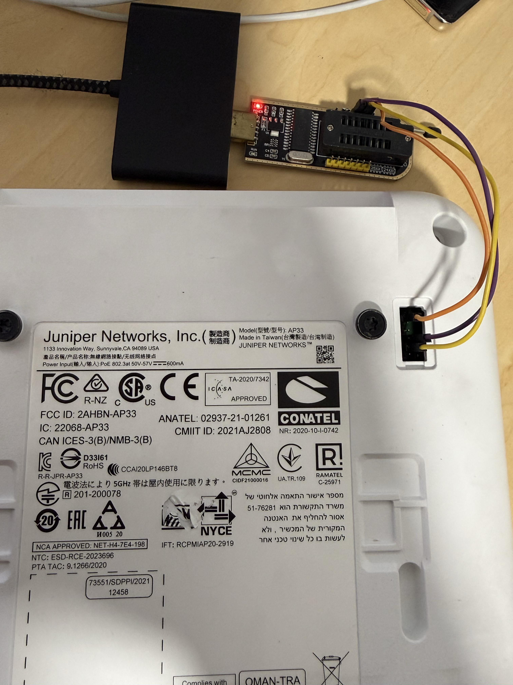

# Juniper AP33 onboarding

This walkthrough brings an AP33 under Dismist management. It applies when you
can reach a root shell on **that AP**, either through an existing
owner-approved SSH login or the verified legacy 0.8 serial login described
below. Before its first connection Dismist needs the AP's own authentication
secret, and the AP needs a `cloud.ini` and CA bundle in `/rw` that point it at
Dismist and trust its certificate. `dismist ap33 onboard` does all of that in
one command once root SSH works (§3); the same steps by hand are in the
[appendix](#appendix-manual-preparation). A stock AP with only the newer
signed serial login has no verified, general offline preparation path.

Dismist identifies the AP by the ID it authenticates with (its base MAC), not
by its address, so several APs can sit behind one NAT. See
[AP onboarding](../onboarding.md) for how identity, secrets and the two
endpoint modes work.

Replace the example addresses and paths with values verified on **your**
AP. Backups hold the AP's secret: keep them private and out of any Git
checkout. The commands assume `dismist` is on your `PATH`; prefix it with
`./` when using an extracted release archive.

## 1. Prepare Dismist and the network

1. Run the controller: the Helm chart ([Kubernetes](../kubernetes.md)) or
   `dismistd` on a host ([deployment](../deployment.md)). Install the
   `dismist` CLI on a laptop that is on the AP's LAN, from
   [GitHub Releases](https://github.com/nicko170/dismist/releases) or with
   `go install github.com/nicko170/dismist/cmd/dismist@latest`.
2. Choose how the AP reaches the controller:
   - **Custom endpoint with a public certificate (recommended).** Give the
     controller's AP endpoint a DNS name, for example `ap.example.net`, and
     serve a certificate for it from a public CA. The Helm chart requests a
     Let's Encrypt certificate through cert-manager. The AP's `cloud.ini`
     then names `wss://ap.example.net/ws` and its bundle gains Let's
     Encrypt's roots (ISRG Root X1, X2, Root YE and Root YR, all four so the
     AP survives chain rotations); `dismist ap33 onboard` adds them. The
     AP's DNS stays as it is, the AP needs no pinned address, and the
     controller can be anywhere the AP reaches on TCP 443.
   - **Custom endpoint with your own CA.** As above, with the certificate
     from your CA; pass the CA to onboard with `--ca`.
   - **DNS mode.** Keep the stock `ep-terminator.mistsys.net` name and let
     dismistd answer it (the certificate `dismist init` creates is for that
     name). Point the AP management LAN's DNS at dismistd; it answers the
     Mist name **only to pinned AP source addresses**, so every AP in DNS
     mode is onboarded with `--pin-ip`.
3. Plan the client WLAN VLAN, switch trunk, gateway, and DHCP scope. The
   physical AP uplink must carry the client VLAN. Dismist adds enabled site
   WLAN VLANs to the AP's Ethernet `SwitchPorts` allow lists when the base
   config contains those ports.
4. Create a site with its country (AU sites run AU/890), a WLAN, and an API
   token with admin scope (System › API tokens) saved on one line in
   `~/.config/dismist/token` (mode 600).

## 2. Inspect the serial boot and identify the firmware



With the AP's back facing you as shown, the six positions in the recessed
header run **top to bottom** in this order. Signal names are from the AP's
perspective:

| Position | AP signal | Wire in photo | Connect to adapter |
| --- | --- | --- | --- |
| 1 | GND | Orange | GND |
| 2 | NC | None | Leave disconnected |
| 3 | NC | None | Leave disconnected |
| 4 | RX | Purple | TX |
| 5 | TX | Yellow | RX |
| 6 | NC | None | Leave disconnected |

Use a USB UART adapter at the voltage and pinout verified for **your board**.
Connect ground, adapter RX to AP TX, and adapter TX to AP RX; do not connect
the adapter's power pin. Power the AP separately with PoE. Open an 8N1 terminal
at 115200 baud (substitute your serial device), then power or reboot the AP.
GNU Screen's `-L` records the
boot in the ignored private directory:

```sh
umask 077
mkdir -p data/ap33/ap33-01
(cd data/ap33/ap33-01 && screen -L /dev/ttyUSB0 115200)
# macOS serial device example: /dev/cu.usbserial-XXXX
```

Record the `MAC:` line, `boot:` / `boot config` lines, `Firmware version :`
line, and Linux `mist_aplx login:` prompt. The firmware line identifies the
**slot that actually booted**. In the observed two-slot layout, `i1` in
`boot config` selected `rootfs1` and `i2` selected `rootfs2`; `c` is a boot
counter, not a firmware version. A `0.8.21758` boot presented the legacy
`A|...|root|...` challenge. Observed `0.14.29091` and `0.15.35064` boots
presented signed `C` challenges. Identify the challenge by decoding it or by
running the tool below; the visible `B` prefix alone does **not** distinguish
the modes. Do not infer the contents of the inactive slot from a boot log.

If you already have root over SSH, `dismist ap33 inspect` reads the running
firmware, uptime, boot count, `bootcfg` slot, root volume, EEPROM size,
`cloud.ini` URLs, CA bundle subjects, any `local_*` override files and the
tail of the ep-control, system and kernel logs, without writing anything:

```sh
dismist ap33 inspect root@192.0.2.101
```

It speaks SSH itself and already allows the SHA-1 `ssh-rsa` signatures the
0.8 image's dropbear needs (use an RSA key there: that dropbear has no
ed25519). Pass `-i KEY` for a specific key; see
[SSH options](../onboarding.md#ssh-options). To inspect both slots, run on the
AP without changing either one:

```sh
cat /etc/mist/version
/sbin/bootcfg
mount | grep ' on / '
ubinfo -a
mkdir -p /tmp/ap33-inactive
# Replace rootfs2 with the inactive name shown by mount and ubinfo.
mount -t ubifs -o ro ubi0:rootfs2 /tmp/ap33-inactive
cat /tmp/ap33-inactive/etc/mist/version
umount /tmp/ap33-inactive
```

Check that `mount` reports `ubi0:rootfs1` or `ubi0:rootfs2` on `/`, and
substitute the **other** volume in the read-only mount command. If `ubinfo`
or the inactive volume is absent, investigate that unit rather than assuming
a recovery image exists. Record model, serial number, firmware in each slot,
Ethernet MAC, and management IP. The controller ID is the Ethernet MAC in
dash form, such as `aa-bb-cc-00-00-01`.

### Legacy 0.8 serial root login

The following was verified on a unit that had a 0.8 recovery image. If the
boot log already says `0.8.21758`, enter `root` at `mist_aplx login:`. Copy
the complete `challenge:` value, including the leading `B`, and run on the
laptop:

```sh
dismist ap33 serial-response '<complete-B-challenge>'
```

Paste the single output line at `response:`. It is specific to that fresh
challenge; generate a new response for every login attempt. Confirm `id -u`
prints `0` before changing files. The tool validates a dashed hexadecimal
MAC and the A-mode root framing, then uses the 0.8 firmware's HMAC constants
and a random client nonce. Those constants are not the AP's EEPROM secret.

On one unit, the newer firmware's passwordless `manufacturing` serial menu
offered `e` for a software reboot. At `mist_aplx login:`, enter
`manufacturing`, then press `e` in that menu. Repeating this software reboot
let the boot counter fall through from `i1` to an **already present** 0.8 `i2`
recovery image. Watch every `boot config` and `Firmware version :` line; stop
when the 0.8 image boots. This is an observed fallback behavior, not a way to
create an old slot or a general root method. If you have no evidence that
your other slot contains 0.8, do not rely on the fallback. Do not use U-Boot
`progfw`, erase a slot, or alter EEPROM to obtain root.

On 0.14/0.15, entering `root` gives a signed C-mode challenge. The legacy
tool rejects it. The firmware's public verification key cannot generate a
signature; this project has no matching private signing key. If both usable
slots are C-only and you lack another verified root path, stop before changing
DNS, resetting the AP, or trying to install a CA.

### Move from serial root to file transfer

The commands below use SSH to transfer binary files. If serial is your only
root access, first inspect `ip -4 addr`, `/etc/init.d/dropbear`, and
`/root/.ssh/authorized_keys` on the AP. On the observed 0.8 image, Dropbear
reads `/tmp/root/.ssh/authorized_keys`. Generate a dedicated RSA key on the
laptop under the ignored directory, paste **only its public key** into the
AP's root console, and test SSH before continuing:

```sh
umask 077
mkdir -p data/ap33/ap33-01
ssh-keygen -t rsa -b 3072 -N '' -f data/ap33/ap33-01/transfer_rsa
cat data/ap33/ap33-01/transfer_rsa.pub
```

On the AP serial root shell, use the following, paste that one public-key
line, then press Ctrl-D:

```sh
mkdir -p /tmp/root/.ssh
chmod 700 /tmp/root/.ssh
cat >> /tmp/root/.ssh/authorized_keys
chmod 600 /tmp/root/.ssh/authorized_keys
```

Back on the laptop, use its actual management IP:

```sh
ssh -o PubkeyAcceptedAlgorithms=+ssh-rsa \
  -i data/ap33/ap33-01/transfer_rsa root@192.0.2.101 id -u
```

If that prints `0`, load the private key into an available SSH agent with
`ssh-add data/ap33/ap33-01/transfer_rsa` before using the commands below. If
you do not use an agent, pass `-i data/ap33/ap33-01/transfer_rsa` to each
`ssh` command. On a 0.8 image that requires SHA-1 RSA signatures, also pass
`-o PubkeyAcceptedAlgorithms=+ssh-rsa` to each command. The key in `/tmp` is
temporary. If the AP's SSH layout differs or the login fails, use a
separately verified private transfer method; do not treat an unverified key
path as persistent access.

## 3. Onboard the AP

Cross-check the chassis label's model and serial number against your
inventory and the boot log's Ethernet MAC. Each AP has a unique 32-byte
EEPROM authentication secret; the claim QR/code and a site SSH key do not
contain it. Then, from the laptop:

```sh
dismist ap33 inspect root@192.0.2.101            # read-only: firmware, slot, EEPROM, local files
dismist ap33 onboard root@192.0.2.101 --controller https://dismist.example.net \
  --token-file ~/.config/dismist/token --site Home --name Hallway --dry-run
dismist ap33 onboard root@192.0.2.101 --controller https://dismist.example.net \
  --token-file ~/.config/dismist/token --site Home --name Hallway
```

The **Add an AP** page in the UI builds the same command for you. The dry
run checks everything (token, site, root, firmware, EEPROM, local files,
the new `cloud.ini` and bundle, and the chain the endpoint serves against
that bundle) and changes nothing. The real run then:

1. backs up `/rw` and the full EEPROM to
   `~/.local/share/dismist/backups/<id>/<UTC time>/` (0600 files with a
   `SHA256SUMS`);
2. reads the secret at EEPROM offset `0x400` into memory (never printed);
3. writes `/rw/etc/mist/ep-control/cacerts-production.pem` (the AP's own
   bundle plus the controller's roots) and then `cloud.ini` (the firmware's
   stock file with both `[[cloud]]` URLs set to the endpoint and `rootcerts`
   pointed at the `/rw` bundle; TLS verification stays on), verifying each
   by SHA-256 on the AP;
4. registers the AP in the site (or refreshes its registration);
5. reboots it and waits until it is connected and in sync.

If the AP has `local_*` files in `/rw/etc/mist/ep-control/`, the command
stops and asks: they are merged into whatever config the controller sends,
so the AP would not run exactly what Dismist shows. Keep them with `--yes`
or move them aside with `--remove-local-files`. In DNS mode add `--pin-ip`
(and `--ca data/ca.crt` for the local CA). The command reference, exit codes
and every option are in [AP onboarding](../onboarding.md#onboard-with-the-cli).

Check the intended firmware slot (`bootcfg` in `dismist ap33 inspect`)
before the reboot, and keep a proven 0.8 recovery slot intact; onboarding
never writes either slot or the EEPROM.

## 4. Verify

1. The CLI ends with `Done: <id> (AP33-WW, apfw-…) is connected and in sync
   at rev N`, and the Verify panel (`/onboard/register?step=verify&id=<id>`)
   shows every step done, ending with the site's WLANs broadcasting on 2.4
   and 5 GHz.
2. The AP's page shows its LAN address as the AP reports it and the public
   address its session comes from, and its applied revision equals its
   config revision. A saved WLAN alone does not prove success.
3. Join a test client. Verify its IP comes from the intended client VLAN, and
   test the gateway, DNS, and internet. An associated client with a
   `169.254.0.0/16` address has not obtained a DHCP lease; check the AP
   `SwitchPorts`, physical trunk, and DHCP scope.
4. Confirm the slot and firmware after the reboot with
   `dismist ap33 ssh root@192.0.2.101 status`.

## 5. Undo, move and reboot

- **Undo**: `dismist ap33 restore root@192.0.2.101 --backup ~/.local/share/dismist/backups/<id>/<time>`
  puts back the `cloud.ini`, CA bundle and `local_*` files from that backup,
  moves anything that did not exist then aside, and reboots. The AP returns
  to the endpoint and trust it had before.
- **Move to another controller or endpoint name**:
  `dismist ap33 onboard --retarget root@192.0.2.101 --controller … --token-file …`
  rewrites `cloud.ini` and the bundle only.
- **Reboot** from the LAN: `dismist ap33 ssh root@192.0.2.101 reboot --yes`
  (records the reason, so the AP's next hello does not report an
  unexplained reboot).

Site Settings can add operator SSH *public* keys, which Dismist sends to
already-authenticated APs in the site; they do not replace preparation. APs
can later move between sites and receive the destination site's config.

## APs still claimed in Mist (0.14 and 0.15)

A 0.14 or 0.15 AP that is still claimed in a Mist organisation has only the
signed serial login and no root SSH of its own. The suggested route is to add
your public key to the Mist site's `ssh_keys` and wait for the AP to take the
config, then SSH in as root and run `dismist ap33 onboard`. **This route is
unverified: the Mist site `ssh_keys` were not observed to grant root on the
AP33s examined so far** (design Q16). Do not release such an AP from Mist,
reset it or change its DNS on the strength of this route; record any
successful attempt in [verification](../verification.md) first.

## Current limits

- There is no verified offline induction method for an AP33 whose available
  firmware slots both require the newer signed serial login. On firmware
  studied so far, Factory Reset reformats `/rw` and removes local trust
  without revealing the EEPROM secret; U-Boot `progfw` also erases `/rw`.
- The AP's two root filesystems are separate from their shared `/rw` volume.
  Preserve a confirmed 0.8 recovery image and a private `/rw` backup through
  later firmware changes. A root login on one slot does not mean that slot's
  login method works on the other.
- Dismist includes an AP33 base config tested on firmware 0.15. Check the
  effective config and AP apply result on other firmware before connecting
  clients; a custom template remains available for a different model or
  firmware generation.
- Multiple wired APs can share a site. Mesh backhaul, BLE presence, and
  direct AP BLE-to-MQTT export are still being validated; assigning APs to a
  site alone does not enable mesh.

If any prerequisite fails, keep the AP's original firmware and network
settings while you investigate that unit. The controller cannot infer or
replace its unique authentication secret.

## Appendix: manual preparation

The steps `dismist ap33 onboard` automates, for doing them by hand or
checking what it did. Run them from a private directory (for example the
`data/` directory `dismist init` created). The **Add an AP** page's *Trust
material* card shows the controller's WSS URL, a **Download CA bundle**
button and the `cloud.ini` to install.

### Back up the AP and extract its own secret

Cross-check the chassis label's model and serial number against your inventory
and the boot log's Ethernet MAC. Each AP has a unique 32-byte EEPROM
authentication secret; the claim QR/code and a site SSH key do not contain it.

Once root SSH works, back up `/rw` and inspect the EEPROM device. The example
path below was observed on an AP33, but it must be checked on each unit before
use:

```sh
AP_IP=192.0.2.101
AP_LABEL=ap33-01
EEPROM_PATH=/sys/bus/i2c/devices/0-0052/eeprom
umask 077
mkdir -p "data/ap33/$AP_LABEL"
ssh root@"$AP_IP" 'cat /etc/mist/version; cat /proc/mtd; /sbin/bootcfg'
ssh root@"$AP_IP" 'tar -C /rw -czf - .' \
  > "data/ap33/$AP_LABEL/rw.tar.gz"
gzip -t "data/ap33/$AP_LABEL/rw.tar.gz"
ssh root@"$AP_IP" 'ls -l /sys/bus/i2c/devices/*/eeprom'
ssh root@"$AP_IP" "wc -c < '$EEPROM_PATH'"
```

Continue only if the selected EEPROM file is the expected 32,768 bytes.
The authentication secret begins at offset `0x400` in the observed AP33
layout. Read the full EEPROM and secret without printing either value:

```sh
ssh root@"$AP_IP" "cat '$EEPROM_PATH'" \
  > "data/ap33/$AP_LABEL/eeprom.bin"
ssh root@"$AP_IP" \
  "dd if='$EEPROM_PATH' bs=1 skip=1024 count=32 2>/dev/null" \
  > "data/ap33/$AP_LABEL/secret.bin"
test "$(wc -c < "data/ap33/$AP_LABEL/eeprom.bin")" -eq 32768
test "$(wc -c < "data/ap33/$AP_LABEL/secret.bin")" -eq 32
chmod 600 "data/ap33/$AP_LABEL/eeprom.bin" \
  "data/ap33/$AP_LABEL/secret.bin"
```

These commands only read the AP. You upload `secret.bin` when you register
the AP (below); Dismist keeps it in its database, so the server needs no secret
file. Keep `secret.bin` and `eeprom.bin` private and offline as part of the
AP's backup. Never substitute a random secret or reuse another AP's EEPROM.
Before any firmware write, also back up the unit's MTD/UBI volumes and confirm
a recovery route.

Check the `/rw` backup for override files before going further:

```sh
tar -tzf "data/ap33/$AP_LABEL/rw.tar.gz" | grep 'ep-control/local_' || echo none
```

`local_*` files in `/rw/etc/mist/ep-control/` are merged into whatever config
the controller sends, so the AP will not run exactly what Dismist shows while
they exist. `dismist ap33 inspect` lists them with their hashes and key paths.

### Install the endpoint and trust

Obtain `cloud.ini` and `cacerts-production.pem` from the **same AP and
firmware**. The `dismist ap33 prepare-trust` command checks the stock WSS
endpoint and CA path, preserves the vendor CAs, appends the CAs you give it,
points every `rootcerts` setting at
`/rw/etc/mist/ep-control/cacerts-production.pem` (the public CA bundle path
the AP reads from `/rw`), and keeps TLS verification enabled. It stops if the
source format differs from the version it knows.

```sh
mkdir -p "data/ap33/$AP_LABEL/stock/etc/mist/ep-control"
ssh root@"$AP_IP" 'cat /etc/mist/ep-control/cloud.ini' \
  > "data/ap33/$AP_LABEL/stock/etc/mist/ep-control/cloud.ini"
ssh root@"$AP_IP" 'cat /etc/mist/ep-control/cacerts-production.pem' \
  > "data/ap33/$AP_LABEL/stock/etc/mist/ep-control/cacerts-production.pem"
```

**Custom endpoint.** `--url` sets both `[[cloud]]` `url` keys (the production
entry and the factory entry) to the controller's WSS URL. Give
`--controller-ca` once for each root that issues the certificate the endpoint
serves. For a Let's Encrypt certificate those are its public roots (ISRG Root
X1 and ISRG Root X2, plus the newer Root YE and Root YR if your chain uses
them), downloaded from the CA and checked against its published
fingerprints; for a certificate from your own CA it is that CA's root.
Including every root of the CA's current hierarchy keeps the AP connecting
when the CA rotates its intermediates.

```sh
dismist ap33 prepare-trust \
  --stock-dir "data/ap33/$AP_LABEL/stock" \
  --url wss://ap.example.net/ws \
  --controller-ca roots/isrg-root-x1.pem --controller-ca roots/isrg-root-x2.pem \
  --output "data/ap33/$AP_LABEL/overlay"
dismist ap33 check-trust --url wss://ap.example.net/ws \
  --bundle "data/ap33/$AP_LABEL/overlay/etc/mist/ep-control/cacerts-production.pem"
```

Continue only if `check-trust` prints `OK`. It connects to the endpoint, prints
the chain it serves and verifies it against the new bundle alone, which is
what the AP will do. (`openssl s_client -CAfile` is not a reliable substitute:
it can also consult the machine's own roots, and on macOS always does.)

**DNS mode.** Leave out `--url`, so the AP keeps the stock name, and add the
local CA:

```sh
dismist ap33 prepare-trust \
  --stock-dir "data/ap33/$AP_LABEL/stock" \
  --controller-ca data/ca.crt --output "data/ap33/$AP_LABEL/overlay"
```

Then install both files on the AP and compare them:

```sh
ssh root@"$AP_IP" \
  'umask 077; mkdir -p /rw/etc/mist/ep-control; cat > /rw/etc/mist/ep-control/cloud.ini; chmod 600 /rw/etc/mist/ep-control/cloud.ini' \
  < "data/ap33/$AP_LABEL/overlay/etc/mist/ep-control/cloud.ini"
ssh root@"$AP_IP" \
  'umask 077; cat > /rw/etc/mist/ep-control/cacerts-production.pem; chmod 600 /rw/etc/mist/ep-control/cacerts-production.pem' \
  < "data/ap33/$AP_LABEL/overlay/etc/mist/ep-control/cacerts-production.pem"
ssh root@"$AP_IP" 'cat /rw/etc/mist/ep-control/cloud.ini' \
  | cmp "data/ap33/$AP_LABEL/overlay/etc/mist/ep-control/cloud.ini" -
ssh root@"$AP_IP" 'cat /rw/etc/mist/ep-control/cacerts-production.pem' \
  | cmp "data/ap33/$AP_LABEL/overlay/etc/mist/ep-control/cacerts-production.pem" -
```

Keep the original `/rw` backup. Both `cmp` commands must exit successfully
before reboot. `dismist ap33 inspect root@"$AP_IP"` should now show the
`/rw` cloud config overriding the firmware copy, the expected URL in both
entries, and the added roots in the CA bundle. A site SSH key added in
Dismist cannot bootstrap this step. Do not disable TLS verification to work
around a failed trust check.

### Register

In **Add an AP › Register manually**, enter the MAC-derived ID, a name, the
site and the secret (upload `secret.bin`, or paste its hex:
`od -An -tx1 secret.bin | tr -d ' \n'`). Leave **Pinned source IP** empty
for a custom endpoint; in DNS mode it is required. Then reboot the AP with
`dismist ap33 ssh root@"$AP_IP" reboot --yes` and watch the Verify panel.

