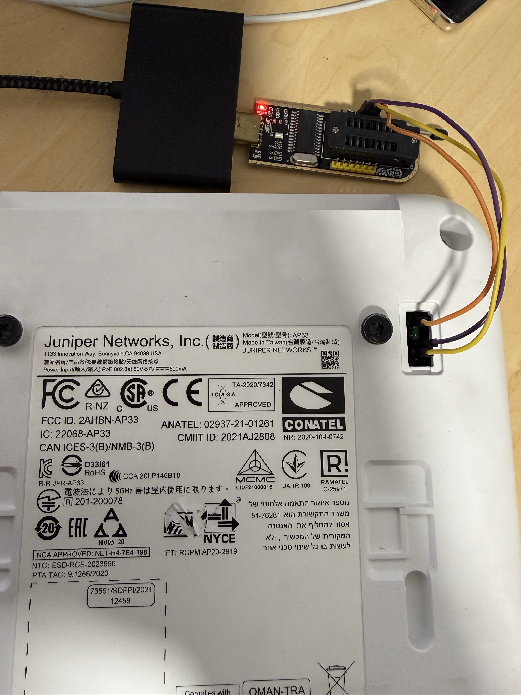

# Juniper AP33 onboarding

This walkthrough brings an AP33 under Dismist management on a local network.
It applies when you can reach a root shell on **that AP**, either through an
existing owner-approved SSH login or the verified legacy 0.8 serial login
described below. Dismist needs the AP's own authentication secret and a local
CA installed on the AP before its first connection. A stock AP with only the
newer signed serial login has no verified, general offline preparation path.

Run the commands from the directory where `dismist init` created `data/`.
Replace the example management IP, file label, and EEPROM path with values
verified on **your** AP. Keep every backup and secret under that private
`data/` directory.
The commands assume `dismist` and `dismistd` are on your `PATH`; prefix them
with `./` when using an extracted release archive.

## 1. Prepare Dismist and the network

1. Install the two binaries from [GitHub Releases](https://github.com/nicko170/dismist/releases)
   or with `go install github.com/nicko170/dismist/cmd/...@latest`, then
   initialize a private working directory:

   ```sh
   dismist init
   ```

   This prints the new admin token and creates the local CA, WSS certificate,
   and a bundled AP33 base configuration automatically. You will choose the
   site country, SSID, client VLAN, and passphrase in the UI. No AP config
   JSON needs to be supplied.
2. Give the server a stable IPv4 address that the AP management LAN can reach.
   The default listeners are UI TCP 8088, AP WSS TCP 443, and AP DNS UDP/TCP
   53, all bound to `0.0.0.0`. On a server with multiple IPv4 addresses, set
   `-controller-ip` to the AP-facing address. Arrange the AP management LAN's
   DNS to use that address. Dismist returns it for
   `ep-terminator.mistsys.net` only to registered AP source IPs; it does not
   edit the router or DHCP service.
3. Plan the client WLAN VLAN, switch trunk, gateway, and DHCP scope. The
   physical AP uplink must carry the client VLAN. Dismist adds enabled site
   WLAN VLANs to the AP's Ethernet `SwitchPorts` allow lists when the base
   config contains those ports.

See [deployment](../deployment.md) for service options, certificate
lifetimes, backups, and listener settings.

## 2. Inspect the serial boot and identify the firmware



With the AP's back facing you as shown, the six positions in the recessed
header run **top to bottom** in this order. Signal names are from the AP's
perspective:

| Position | AP signal | Wire in photo | Connect to adapter |
| --- | --- | --- | --- |
| 1 | GND | Orange | GND |
| 2 | NC | None | Leave disconnected |
| 3 | NC | None | Leave disconnected |
| 4 | RX | Purple | TX |
| 5 | TX | Yellow | RX |
| 6 | NC | None | Leave disconnected |

Use a USB UART adapter at the voltage and pinout verified for **your board**.
Connect ground, adapter RX to AP TX, and adapter TX to AP RX; do not connect
the adapter's power pin. Power the AP separately with PoE. Open an 8N1 terminal
at 115200 baud (substitute your serial device), then power or reboot the AP.
GNU Screen's `-L` records the
boot in the ignored private directory:

```sh
umask 077
mkdir -p data/ap33/ap33-01
(cd data/ap33/ap33-01 && screen -L /dev/ttyUSB0 115200)
# macOS serial device example: /dev/cu.usbserial-XXXX
```

Record the `MAC:` line, `boot:` / `boot config` lines, `Firmware version :`
line, and Linux `mist_aplx login:` prompt. The firmware line identifies the
**slot that actually booted**. In the observed two-slot layout, `i1` in
`boot config` selected `rootfs1` and `i2` selected `rootfs2`; `c` is a boot
counter, not a firmware version. A `0.8.21758` boot presented the legacy
`A|...|root|...` challenge. Observed `0.14.29091` and `0.15.35064` boots
presented signed `C` challenges. Identify the challenge by decoding it or by
running the tool below; the visible `B` prefix alone does **not** distinguish
the modes. Do not infer the contents of the inactive slot from a boot log.

If you already have root, inspect both slots without changing either one:

```sh
cat /etc/mist/version
/sbin/bootcfg
mount | grep ' on / '
ubinfo -a
mkdir -p /tmp/ap33-inactive
# Replace rootfs2 with the inactive name shown by mount and ubinfo.
mount -t ubifs -o ro ubi0:rootfs2 /tmp/ap33-inactive
cat /tmp/ap33-inactive/etc/mist/version
umount /tmp/ap33-inactive
```

Check that `mount` reports `ubi0:rootfs1` or `ubi0:rootfs2` on `/`, and
substitute the **other** volume in the read-only mount command. If `ubinfo`
or the inactive volume is absent, investigate that unit rather than assuming
a recovery image exists. Record model, serial number, firmware in each slot,
Ethernet MAC, and management IP. The controller ID is the Ethernet MAC in
dash form, such as `aa-bb-cc-00-00-01`.

### Legacy 0.8 serial root login

The following was verified on a unit that had a 0.8 recovery image. If the
boot log already says `0.8.21758`, enter `root` at `mist_aplx login:`. Copy
the complete `challenge:` value, including the leading `B`, and run on the
laptop:

```sh
dismist ap33 serial-response '<complete-B-challenge>'
```

Paste the single output line at `response:`. It is specific to that fresh
challenge; generate a new response for every login attempt. Confirm `id -u`
prints `0` before changing files. The tool validates a dashed hexadecimal
MAC and the A-mode root framing, then uses the 0.8 firmware's HMAC constants
and a random client nonce. Those constants are not the AP's EEPROM secret.

On one unit, the newer firmware's passwordless `manufacturing` serial menu
offered `e` for a software reboot. At `mist_aplx login:`, enter
`manufacturing`, then press `e` in that menu. Repeating this software reboot
let the boot counter fall through from `i1` to an **already present** 0.8 `i2`
recovery image. Watch every `boot config` and `Firmware version :` line; stop
when the 0.8 image boots. This is an observed fallback behavior, not a way to
create an old slot or a general root method. If you have no evidence that
your other slot contains 0.8, do not rely on the fallback. Do not use U-Boot
`progfw`, erase a slot, or alter EEPROM to obtain root.

On 0.14/0.15, entering `root` gives a signed C-mode challenge. The legacy
tool rejects it. The firmware's public verification key cannot generate a
signature; this project has no matching private signing key. If both usable
slots are C-only and you lack another verified root path, stop before changing
DNS, resetting the AP, or trying to install a CA.

### Move from serial root to file transfer

The commands below use SSH to transfer binary files. If serial is your only
root access, first inspect `ip -4 addr`, `/etc/init.d/dropbear`, and
`/root/.ssh/authorized_keys` on the AP. On the observed 0.8 image, Dropbear
reads `/tmp/root/.ssh/authorized_keys`. Generate a dedicated RSA key on the
laptop under the ignored directory, paste **only its public key** into the
AP's root console, and test SSH before continuing:

```sh
umask 077
mkdir -p data/ap33/ap33-01
ssh-keygen -t rsa -b 3072 -N '' -f data/ap33/ap33-01/transfer_rsa
cat data/ap33/ap33-01/transfer_rsa.pub
```

On the AP serial root shell, use the following, paste that one public-key
line, then press Ctrl-D:

```sh
mkdir -p /tmp/root/.ssh
chmod 700 /tmp/root/.ssh
cat >> /tmp/root/.ssh/authorized_keys
chmod 600 /tmp/root/.ssh/authorized_keys
```

Back on the laptop, use its actual management IP:

```sh
ssh -o PubkeyAcceptedAlgorithms=+ssh-rsa \
  -i data/ap33/ap33-01/transfer_rsa root@192.0.2.101 id -u
```

If that prints `0`, load the private key into an available SSH agent with
`ssh-add data/ap33/ap33-01/transfer_rsa` before using the commands below. If
you do not use an agent, pass `-i data/ap33/ap33-01/transfer_rsa` to each
`ssh` command. On a 0.8 image that requires SHA-1 RSA signatures, also pass
`-o PubkeyAcceptedAlgorithms=+ssh-rsa` to each command. The key in `/tmp` is
temporary. If the AP's SSH layout differs or the login fails, use a
separately verified private transfer method; do not treat an unverified key
path as persistent access.

## 3. Back up the AP and extract its own secret

Cross-check the chassis label's model and serial number against your inventory
and the boot log's Ethernet MAC. Each AP has a unique 32-byte EEPROM
authentication secret; the claim QR/code and a site SSH key do not contain it.

Once root SSH works, back up `/rw` and inspect the EEPROM device. The example
path below was observed on an AP33, but it must be checked on each unit before
use:

```sh
AP_IP=192.0.2.101
AP_LABEL=ap33-01
EEPROM_PATH=/sys/bus/i2c/devices/0-0052/eeprom
umask 077
mkdir -p "data/ap33/$AP_LABEL"
ssh root@"$AP_IP" 'cat /etc/mist/version; cat /proc/mtd; /sbin/bootcfg'
ssh root@"$AP_IP" 'tar -C /rw -czf - .' \
  > "data/ap33/$AP_LABEL/rw.tar.gz"
gzip -t "data/ap33/$AP_LABEL/rw.tar.gz"
ssh root@"$AP_IP" 'ls -l /sys/bus/i2c/devices/*/eeprom'
ssh root@"$AP_IP" "wc -c < '$EEPROM_PATH'"
```

Continue only if the selected EEPROM file is the expected 32,768 bytes.
The authentication secret begins at offset `0x400` in the observed AP33
layout. Read the full EEPROM and secret without printing either value:

```sh
ssh root@"$AP_IP" "cat '$EEPROM_PATH'" \
  > "data/ap33/$AP_LABEL/eeprom.bin"
ssh root@"$AP_IP" \
  "dd if='$EEPROM_PATH' bs=1 skip=1024 count=32 2>/dev/null" \
  > "data/ap33/$AP_LABEL/secret.bin"
test "$(wc -c < "data/ap33/$AP_LABEL/eeprom.bin")" -eq 32768
test "$(wc -c < "data/ap33/$AP_LABEL/secret.bin")" -eq 32
chmod 600 "data/ap33/$AP_LABEL/eeprom.bin" \
  "data/ap33/$AP_LABEL/secret.bin"
```

These commands only read the AP. Make `secret.bin` readable by the Dismist
service account without changing its private file mode. Never substitute a
random secret or reuse another AP's EEPROM. Before any firmware write, also
back up the unit's MTD/UBI volumes and confirm a recovery route.

## 4. Install local WSS trust

Obtain `cloud.ini` and `cacerts-production.pem` from the **same AP and
firmware**. The `dismist ap33 prepare-trust` command checks the stock WSS
endpoint and CA path, preserves the vendor CAs, adds `data/ca.crt`, and keeps
TLS verification enabled. It stops if the source format differs from the
version it knows.

```sh
mkdir -p "data/ap33/$AP_LABEL/stock/etc/mist/ep-control"
ssh root@"$AP_IP" 'cat /etc/mist/ep-control/cloud.ini' \
  > "data/ap33/$AP_LABEL/stock/etc/mist/ep-control/cloud.ini"
ssh root@"$AP_IP" 'cat /etc/mist/ep-control/cacerts-production.pem' \
  > "data/ap33/$AP_LABEL/stock/etc/mist/ep-control/cacerts-production.pem"
dismist ap33 prepare-trust \
  --stock-dir "data/ap33/$AP_LABEL/stock" \
  --controller-ca data/ca.crt --output "data/ap33/$AP_LABEL/overlay"
ssh root@"$AP_IP" \
  'umask 077; mkdir -p /rw/etc/mist/ep-control; cat > /rw/etc/mist/ep-control/cloud.ini; chmod 600 /rw/etc/mist/ep-control/cloud.ini' \
  < "data/ap33/$AP_LABEL/overlay/etc/mist/ep-control/cloud.ini"
ssh root@"$AP_IP" \
  'umask 077; cat > /rw/etc/mist/ep-control/cacerts-production.pem; chmod 600 /rw/etc/mist/ep-control/cacerts-production.pem' \
  < "data/ap33/$AP_LABEL/overlay/etc/mist/ep-control/cacerts-production.pem"
ssh root@"$AP_IP" 'cat /rw/etc/mist/ep-control/cloud.ini' \
  | cmp "data/ap33/$AP_LABEL/overlay/etc/mist/ep-control/cloud.ini" -
ssh root@"$AP_IP" 'cat /rw/etc/mist/ep-control/cacerts-production.pem' \
  | cmp "data/ap33/$AP_LABEL/overlay/etc/mist/ep-control/cacerts-production.pem" -
```

Keep the original `/rw` backup. Both `cmp` commands must exit successfully
before reboot. A site SSH key added in Dismist cannot bootstrap this step.
Do not disable TLS verification to work around a failed trust check.

## 5. Register and verify

1. Start `dismistd` and sign in to the LAN UI with the token printed by
   `dismist init` (or read `data/admin.token` locally later). Create a site
   and set its country for the AP's regulatory configuration. In **Access
   Points**, register the AP using its
   MAC-derived controller ID, model, **management source IP seen by Dismist**,
   site, and the absolute path to its private `secret.bin`. Each AP needs its
   own ID, IP, and secret. A site can contain multiple APs.
2. Add a site WLAN with an SSID, WPA2 passphrase, enabled state, and client
   VLAN. Review the redacted effective config, especially `SwitchPorts` VLAN
   membership. Site WLANs apply to every AP in that site.
3. Point the AP management LAN's DNS to Dismist and allow traffic to TCP 443
   and UDP/TCP 53. Reboot the AP through a verified management path so it
   reads the `/rw` override. Check the intended firmware slot before reboot,
   then confirm the new boot log's `boot config` and firmware version. Keep a
   proven 0.8 recovery slot intact; this guide does not write either slot.
4. Require **Connected** in the UI and an applied revision equal to the
   desired revision. Confirm the SSID is broadcast, then join a test client.
   Verify its IP comes from the intended client VLAN, and test the gateway,
   DNS, and internet. An associated client with a `169.254.0.0/16` address
   has not obtained a DHCP lease; check the AP `SwitchPorts`, physical trunk,
   and DHCP scope.
5. In **Site Settings**, add operator SSH *public* keys if desired. Dismist
   sends them to already-authenticated APs in that site. APs can later move
   between sites and receive the destination site's config.

The UI updates through site-scoped SSE. Controller metrics are available on
the controller host at `http://127.0.0.1:9090/metrics` by default.

## Current limits

- There is no verified offline induction method for an AP33 whose available
  firmware slots both require the newer signed serial login. On firmware
  studied so far, Factory Reset reformats `/rw` and removes local trust
  without revealing the EEPROM secret; U-Boot `progfw` also erases `/rw`.
- The AP's two root filesystems are separate from their shared `/rw` volume.
  Preserve a confirmed 0.8 recovery image and a private `/rw` backup through
  later firmware changes. A root login on one slot does not mean that slot's
  login method works on the other.
- Dismist includes an AP33 base config tested on firmware 0.15. Check the
  effective config and AP apply result on other firmware before connecting
  clients; a custom template remains available for a different model or
  firmware generation.
- Multiple wired APs can share a site. Mesh backhaul, BLE presence, and
  direct AP BLE-to-MQTT export are still being validated; assigning APs to a
  site alone does not enable mesh.

If any prerequisite fails, keep the AP's original firmware and network
settings while you investigate that unit. The controller cannot infer or
replace its unique authentication secret.
